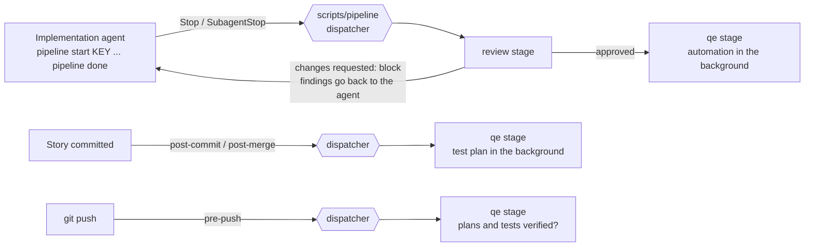

# AI development pipeline

Agents take a user story from implementation to reviewed code with verified tests. The pipeline is a set of independent **stages**, each with its own CLI, config, tests and docs, tied together by one **dispatcher** that every agent tool and git hook calls.

| Stage | Folder | What it does | Docs |
| --- | --- | --- | --- |
| `review` | `scripts/review/` | Architecture review of the implementation by a fresh reviewer, looping with the implementation agent until approved | [review.md](review.md) |
| `qe` | `scripts/qe/` | Story to verified test plan (workflow 1); approved implementation to verified automated tests (workflow 2) | [qe.md](qe.md) |
| `pr-check` | `scripts/pr-check/` | On demand: adversarial critics, defender and judge score a PR against its story (acceptance criteria, flow, UI design, style, video evidence); a fixer loops it to 10/10 | [pr-check.md](pr-check.md) |

Stages run in the order listed in `scripts/pipeline/stages.json`. All of them are Node 20 scripts with no dependencies, and they drive a headless agent CLI: Claude Code by default, or Copilot CLI or Codex (`PIPELINE_AGENT_CLI=copilot|codex`), or any command (`PIPELINE_AGENT_CMD`, prompt on stdin).



## Using it as an implementation agent

```bash
node scripts/pipeline/pipeline.mjs start PROMO-3   # begin a story (or work on a branch named after it)
node scripts/pipeline/pipeline.mjs done            # line of work complete: the stages run when the turn ends
node scripts/pipeline/pipeline.mjs status [PROMO-3]
```

`start` records the active story and tells each stage (the review resets its rounds). `done` marks the work complete; nothing reviews or tests the work until then, so an agent can stop mid-story without triggering anything.

## Lifecycle events

| When | Hook | Dispatcher call | Stages | Cost |
| --- | --- | --- | --- | --- |
| `pipeline start` | (command) | `story-start` | review, qe | none |
| Agent session start/resume | `SessionStart` | `hook session-start` | review, qe | none |
| Agent turn ends | `Stop` and `SubagentStop` | `hook stop` | review, then qe | LLM, only after `pipeline done` |
| Commit or merge | `.githooks/post-commit`, `.githooks/post-merge` | `git-hook post-commit\|post-merge` | qe (plans for changed stories, in the background) | LLM |
| Push | `.githooks/pre-push` | `git-hook pre-push` | qe (plans and tests for touched stories are verified and current) | none |
| Pull request | `.github/workflows/ai-pipeline.yml` | tests, then each stage's reusable workflow (`qe-check.yml`) | all | none |
| Weekly | `.github/workflows/qe-lessons.yml` | `qe calibrate`, `metrics`, `lessons` (opens a PR) | qe | LLM |

`scripts/setup.sh` already points `core.hooksPath` at `.githooks`. `PIPELINE_DISABLE=1` turns every hook off. Agents spawned by the pipeline run with `PIPELINE_CHILD=1`, so their own Stop hooks and git hooks do nothing and cannot recurse. Stage-specific switches (for example `QE_SKIP=1 git push`, `git config qe.autoPlan false`) are listed in each stage's docs.

## The dispatcher

`scripts/pipeline/pipeline.mjs` runs each stage's CLI as a separate process, so a stage that crashes cannot take down the others or the agent.

- **Stop:** stages run in order with the hook payload on stdin. A stage prints nothing, a `systemMessage`, or a Claude-format `{"decision": "block", "reason": ...}`. The first block ends the dispatch, so later stages run only once earlier gates pass; that is how automation waits for the review. Messages are joined. A stage that fails becomes a message, never a broken turn.
- **SessionStart:** each stage prints plain text. The dispatcher adds the active story and open escalations, joins the text and wraps it once: top-level `additionalContext` (Copilot reads only this) plus `hookSpecificOutput` (Claude Code, Cursor). `--nested` emits only the nested form, for Codex, which rejects unknown keys.
- **Git hooks:** stage output goes straight to the terminal. Only `pre-push` can fail, and it fails if any stage fails.
- **`status` and `metrics`:** each stage's own command, grouped by stage (`metrics --json` returns `{ "<stage>": ... }`).

## Agent tool coverage

`.claude/settings.json` is the single source of truth for agent hooks: the dispatcher's `SessionStart`, `Stop` and `SubagentStop` hooks, and the graphify `--strict` guard that denies the first raw grep or file read until `graphify query` has run. Several tools load that file themselves, so they get no file of their own; adding one would run every hook twice.

| Tool | Hook file | Covers | Trust step |
| --- | --- | --- | --- |
| Claude Code | `.claude/settings.json` | all | accept the project's hooks when prompted |
| GitHub Copilot CLI and VS Code agent | `.claude/settings.json` (loaded alongside `.github/hooks/`) | all | add the repo to `trustedFolders` in `~/.copilot/config.json` |
| Cursor | `.claude/settings.json` (third-party hooks, on by default) | all; Cursor has no `Glob` hook | leave Cursor's third-party (Claude) hooks setting on, the default |
| Windsurf / Devin | `.claude/settings.json` | pipeline hooks; the graphify guard matchers don't match its lowercase tool names, so the guard is advisory via `AGENTS.md` | none |
| OpenAI Codex | `.codex/hooks.json` | all; the graphify check covers `Bash` only, Codex's only search tool | trust the project, then approve the hooks in `/hooks` |
| Gemini CLI | `.gemini/settings.json` via `scripts/hooks/gemini-adapter.mjs` | all, `AfterAgent` stands in for `Stop` (no subagent hook) | approve the project hooks when prompted |

`gemini-adapter.mjs` translates Gemini's hook payload and output contract to Claude's, so Gemini runs the same commands.

Not covered: the Copilot cloud agent (its sandbox has no `graphify` or agent CLIs, and a `.github/hooks/` file would duplicate every hook in Copilot CLI), and Cline, Kiro and OpenCode (no way for a hook to block a turn from ending). For those, the git hooks and CI still enforce the stage checks.

## Agent definitions for Copilot and Claude Code

`.github/agents/<name>.agent.md` is the single source for every agent, including `implementer`. Copilot reads it directly, and the stages build their prompts from it. `scripts/sync-agents.mjs` renders each one to `.claude/agents/<name>.md`, so you can run the same agent from Claude Code. The generated copies add Claude-only settings from `scripts/agents-claude.json` (read-only tools for the reviewer and the verifiers, `isolation: worktree` for the implementer) and tell the agent to read its lessons file.

- Edit only `.github/agents/`, then run `npm run agents:sync`.
- If you write a new agent in `.claude/agents/`, `npm run agents:sync` moves it into `.github/agents/` and moves its Claude-only frontmatter to `scripts/agents-claude.json`.
- CI (`npm run agents:check`) fails when the two folders differ.

Every agent ends its final message with `AGENT_RESULT: {json}`, which the stage parses.

## Shared code and state

`scripts/pipeline/lib/` holds what every stage uses: config loading, git helpers, story lookup, per-story state, escalations, the agent runner and background runs.

- **Config:** `scripts/pipeline/config.json` (directories, base ref, agent CLI and default model, which paths count as implementation) is merged with the stage's own `scripts/<stage>/config.json`. Environment overrides: `PIPELINE_AGENT_CLI`, `PIPELINE_AGENT_CMD`, `PIPELINE_BASE_REF`, `PIPELINE_ROOT`.
- **State:** `.agent-state/` (not committed) holds the active story, one `stories/<KEY>.json` per story with a section per stage, locks, background logs (`logs/`) and escalations (`escalations/<KEY>-<stage>.md`, which the next agent session is told about).
- **Metrics:** `.agent-metrics/*.jsonl` (committed; `merge=union` keeps every record across branches). Each stage owns its files.

## Adding a stage

1. Create `scripts/<stage>/<stage>.mjs` using the shared lib (`loadConfig('<stage>')`, `runMain`, `readPayload`). Implement the events it needs: `hook stop` (print nothing, a `systemMessage`, or a block), `hook session-start` (print plain text), `hook story-start <KEY>`, `git-hook <event>` (exit nonzero only on `pre-push` to fail the push), plus `status [story]` and `metrics [--json]`.
2. Add it to `scripts/pipeline/stages.json` in the right order, listing its `hooks`, `gitHooks` and `commands`. A stage that must wait for another reads that stage's section of the story state (as `qe` reads `review.approvedHash`).
3. Put its tests in `scripts/<stage>/test/`; `npm run test:pipeline` and CI pick them up. For a PR gate, add a reusable workflow and call it from `ai-pipeline.yml`.
4. Document it in `docs/ai-pipeline/<stage>.md` and add it to the table above. No agent tool config changes are needed.

## Commands

```bash
node scripts/pipeline/pipeline.mjs start|done|status [KEY]
node scripts/pipeline/pipeline.mjs stages
node scripts/pipeline/pipeline.mjs metrics [--json] [--since 2026-01-01]
node scripts/pipeline/pipeline.mjs hook stop|session-start [--nested]
node scripts/pipeline/pipeline.mjs git-hook post-commit|post-merge|pre-push
node scripts/pr-check/pr-check.mjs run --pr 42 [--no-fix]   # adversarial PR check until 10/10
npm run test:pipeline                     # dispatcher and stage tests (fake agent, no LLM)
```
