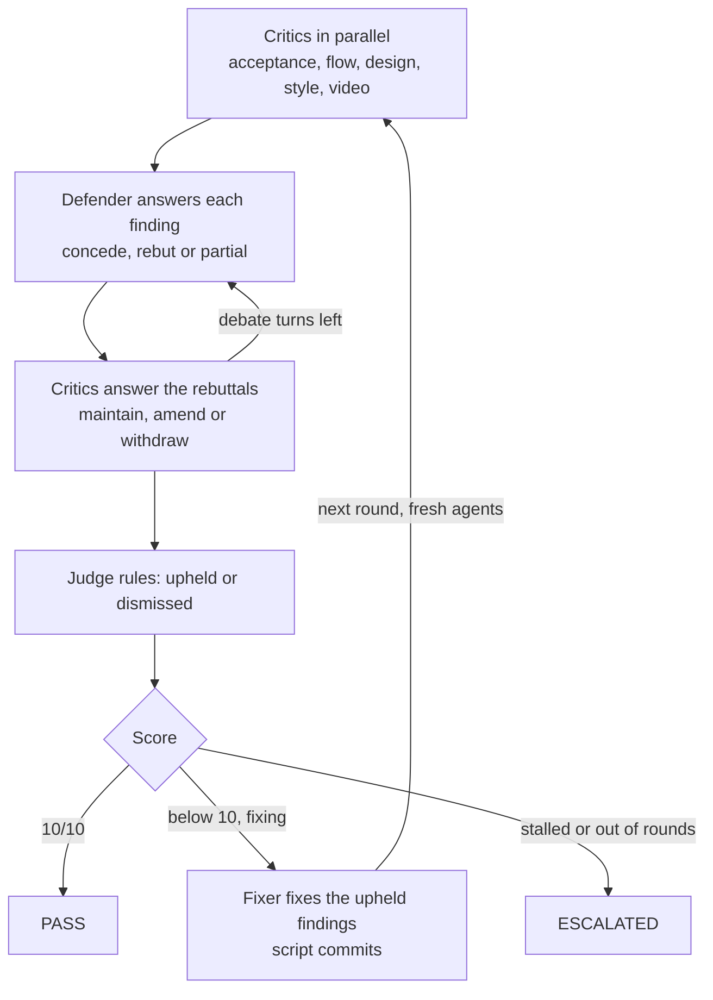

# PR check stage

An extra-large adversarial review of a pull request against its story. Critics argue that the PR falls short, a defender argues that it doesn't, and a judge rules. The script scores the round, a fixer fixes whatever the judge upheld, and fresh agents review again. This repeats until the PR scores **10/10** or the loop escalates to a human.

It checks four things, plus video evidence:

| Lens | Agent | Runs when | Checks |
| --- | --- | --- | --- |
| Acceptance criteria | `pr-check-acceptance` | always | every rule and acceptance criterion in the story is implemented and tested |
| Flow | `pr-check-flow` | always | the end-to-end journey (UI, API, events, data) matches the story's flow, including sad paths |
| UI design | `pr-check-design` | frontend stories (`[FE` in the title, a mockup under `product-research/mockups/<KEY>-*`, or changed Razor/CSS/WebApp files) | layout, components, states and copy match the mockup and the design system |
| Code style | `pr-check-style` | always | the code follows `AGENTS.md`, `.editorconfig`, the architecture docs and the implementer's conventions |
| Video evidence | `pr-check-video` | a video was found | frames show the journey working, with no error banners, 500s, blank screens or broken layouts |

## Running it

```bash
npm run pr-check -- run --pr 42                 # review PR 42 (checked out) and fix it until 10/10
npm run pr-check -- run --pr 42 --no-fix        # one report-only round; the PR doesn't need to be checked out
npm run pr-check -- run --story PROMO-3         # the current branch against a story, no PR needed
npm run pr-check -- run --pr 42 --videos test-results,https://example.com/demo.webm --comment --push
npm run pr-check -- status [pr-42]
npm run pr-check -- metrics [--json] [--since 2026-01-01]
```

Or ask the `pr-check` agent (Copilot or Claude Code) to check a PR; it runs the same command and summarizes the report.

| Option | Default | Meaning |
| --- | --- | --- |
| `--pr <n>` | none | PR to check. Metadata comes from `gh`, or the GitHub API with `GITHUB_TOKEN`/`GH_TOKEN` |
| `--story <KEY>` | from the PR branch, title, body, or the active story | the story the PR is held to |
| `--base <ref>` | the PR base, else `PIPELINE_BASE_REF` | what the diff is taken against |
| `--videos a,b` | links in the PR description, else `test-results/` | video files, folders or URLs |
| `--no-fix` | fix | report only, one round |
| `--max-rounds <n>`, `--debate-turns <n>` | 6, 2 | loop limits |
| `--comment`, `--push` | off | post the report on the PR; push the fix commits |
| `--json` | off | print `result.json` instead of the report |

Exit code 0 means PASS (10/10); anything else is FAIL or ESCALATED. Fix mode needs the PR branch checked out at the PR head with a clean working tree; `--push` is skipped for PRs from forks. report-only mode reviews a PR that isn't checked out in a temporary detached worktree.

## The loop



Every agent call is a new headless process, so each round starts with a clean context. Critics see the previous round's upheld findings and re-raise any that are not fixed, under the same id.

**Scoring is done by the script, not the judge**, so no agent can talk its way to 10:

- An upheld finding caps its lens: blocking at 6, major at 8, minor at 9. The judge's lens score can only lower that.
- A finding the judge didn't rule on stands unless its critic withdrew it.
- Coverage gaps the judge finds without a finding (`<lens>-coverage-<n>`) count as upheld.
- A critic that fails to return a result scores its lens 0.
- The PR's score is the lowest lens score. 10 means nothing was upheld.

The loop escalates (`.agent-state/escalations/<id>-pr-check.md`) when the round limit is reached, when the same finding is upheld three rounds in a row, when the fixer says it can't fix any upheld finding without a human decision, or when the fixer changes nothing two rounds in a row.

## Videos

Videos come from `--videos`, else video links in the PR description (direct `.webm`/`.mp4`/`.mov`/`.mkv` links and GitHub `user-attachments`), else Playwright's `test-results/`. Each is turned into up to 48 frames (one per second at most): with `ffmpeg` when installed, otherwise by playing the file in Playwright's Chromium and screenshotting it. Chromium reads WebM, which is what Playwright records. A video that can't be read is listed in the report and handed to the video critic as an evidence gap.

## Models

The judge and critics run on the largest models. Defaults are in `scripts/pr-check/config.json` per CLI:

| Role | Claude Code | Copilot CLI |
| --- | --- | --- |
| Judge | `opus` | `claude-fable-5.2` |
| Acceptance, flow, design, video critics, fixer | `opus` | `claude-opus-5.5` |
| Defender | `opus` | `claude-opus-5` (a different model from the critics, so the debate isn't one model arguing with itself) |
| Style critic | `sonnet` | `claude-sonnet-5.5` |

Override one role with `PR_CHECK_MODEL_<ROLE>`, for example `PR_CHECK_MODEL_JUDGE=claude-opus-5.5`.

## Files

Each run writes to `.agent-state/pr-check/<id>/` (`<id>` is `pr-<n>`, or the story key):

- `result.json` and `report.md`: the verdict, scores per round and lens, open findings with fixes, findings resolved during the loop, video evidence and what was not checked.
- `context/pr.md`, `context/frames.json` and `videos/`: what the agents were given.
- `round-<n>/`: `diff.patch`, every prompt and agent output, `debate.json` (each finding with its full thread), `coverage.json`, and `rulings.json`.

Every round is appended to `.agent-metrics/pr-checks.jsonl`, which `metrics` and `pipeline metrics` summarize.

## In CI

`.github/workflows/pr-check.yml` runs a report-only check (`--no-fix --comment`) when a PR gets the `ai-pr-check` label, or on demand. It needs the `ANTHROPIC_API_KEY` secret. Fixing stays local, where a person can watch the loop and review its commits.
