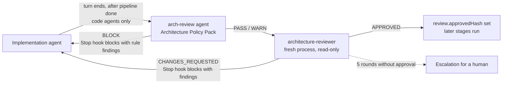

# Review stage

Part of the [AI development pipeline](README.md). Once the implementation agent runs `node scripts/pipeline/pipeline.mjs done`, the review stage runs an architecture review of its work each time the agent's turn ends, and loops with the agent until the code is approved.



- Each round has two steps:
  - The `arch-review` agent (`architecture-policy/agents/arch_review.py review`) evaluates the Architecture Policy Pack rules on the changed files, as requester `implementer`. A `BLOCK` ends the round with changes requested and its rule findings (fix, approved patterns, `explain_finding` command) without an LLM call. `WARN` findings ride along as non-blocking notes. Each later round is linked to the previous policy review with `previous_review_id`, so it reports resolved and persisting findings.
  - Otherwise the `architecture-reviewer` agent reviews the diff.

  Set `review.policy.enabled` to `false` to skip the policy step. If the pack or Python is unavailable, the step is skipped with a note and the LLM review still runs.
- Only code agents are reviewed: the main session's `Stop`, or a `SubagentStop` whose `agent_type` is listed in `review.codeAgents` (default `implementer`).
- The reviewer sees only the story and the implementation diff against the merge base (tests, plans and scenarios excluded, see `implExclude` in `scripts/pipeline/config.json`), plus the repository conventions (`AGENTS.md`, `CONTRIBUTING.md`). It never sees the implementation agent's reasoning.
- Changes requested block the stop and send the findings to the agent as its next instruction. Each correction triggers a new round with a fresh reviewer, up to `review.maxRounds` (5). An approval with blocking findings counts as changes requested.
- If the agent stops again without changing the code, the hook blocks once more, then lets the turn end with a message so it cannot loop forever.
- On approval it records the approved implementation hash in `review.approvedHash` in the story state. The `qe` stage starts automation only for that exact hash, so code changed after an approval is reviewed again first.
- `pipeline start <KEY>` resets the review rounds.

Every round is appended to `.agent-metrics/arch-reviews.jsonl` (story, round, verdict, and each finding's severity, category and file). Rounds blocked by the policy pack carry `reviewer: arch-review-agent`, the `review_id` and each finding's `rule`.

## Commands

```bash
node scripts/review/review.mjs run [PROMO-3]       # one review round now, printed
node scripts/review/review.mjs status [PROMO-3]
node scripts/review/review.mjs metrics [--json] [--since 2026-01-01]
```

Settings: `scripts/review/config.json` (`review.maxRounds`, `review.timeoutSec`, `review.codeAgents`, `review.policy`, `agent.models.reviewer`).
