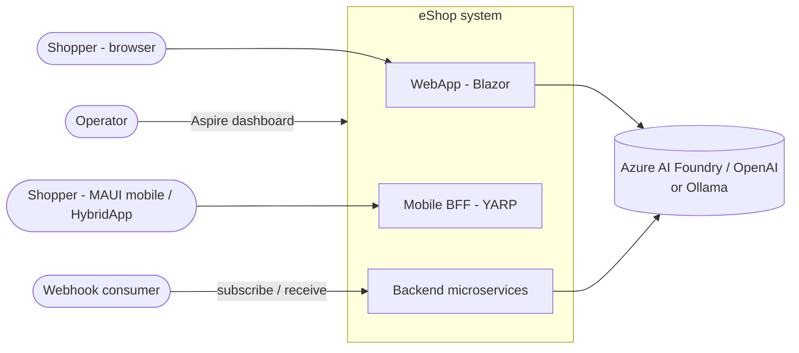
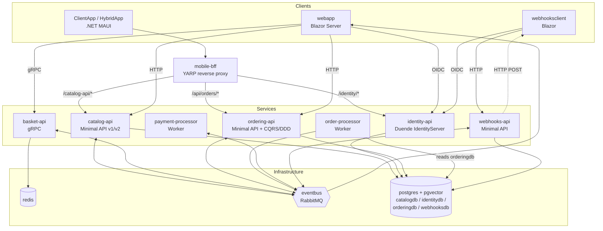

# eShop Architecture

This folder documents the architecture of the eShop reference application as it exists in this repository today.

| Document | Contents |
| --- | --- |
| [README.md](README.md) | System context, container view, technology stack, solution layout |
| [services.md](services.md) | Per-service responsibilities, APIs, data stores, and internal design |
| [event-flows.md](event-flows.md) | Integration event catalog, the order-fulfilment saga, and the outbox pattern |
| [infrastructure.md](infrastructure.md) | Orchestration (Aspire), security, observability, deployment, testing |
| [recommendations.md](recommendations.md) | Gaps, risks, and suggested improvements |

## 1. System context

eShop is a fictional online store selling outdoor gear. Shoppers browse the catalog, use an AI chatbot and semantic search, fill a basket, and check out. Orders move through validation, payment, and shipment asynchronously. Third parties can subscribe to webhooks for order and price events.



## 2. Container view

All resources are declared in [`src/eShop.AppHost/AppHost.cs`](../../src/eShop.AppHost/AppHost.cs).



### Key architectural styles

| Style | Where |
| --- | --- |
| Microservices, database-per-service | Catalog, Ordering, Identity, Webhooks each own a Postgres database; Basket owns Redis |
| Event-driven integration (pub/sub) | RabbitMQ direct exchange `eshop_event_bus`, one durable queue per service |
| Transactional outbox | `IntegrationEventLogEF`, used by Catalog and Ordering |
| DDD + CQRS | Ordering (`Ordering.Domain`, `Ordering.Infrastructure`, MediatR commands/queries) |
| Choreographed saga | Order status transitions driven by integration events |
| Backend-for-frontend | YARP `mobile-bff` for mobile clients |
| Token-based auth (OIDC / OAuth2) | Duende IdentityServer issuing JWTs to APIs |
| Cloud-native orchestration | Aspire AppHost and ServiceDefaults |

## 3. Technology stack

| Concern | Technology |
| --- | --- |
| Runtime | .NET 10 (SDK pinned in `global.json`) |
| Orchestration | Aspire 13.6 (`Aspire.AppHost.Sdk`), Azure Container Apps environment `aca` |
| Web UI | Blazor (interactive server), shared components in `WebAppComponents` |
| Mobile | .NET MAUI (`ClientApp`), MAUI Blazor Hybrid (`HybridApp`) |
| APIs | ASP.NET Core Minimal APIs, `Asp.Versioning`, OpenAPI + Scalar UI |
| RPC | gRPC (`Basket.API/Proto/basket.proto`) |
| Identity | Duende IdentityServer 7 + ASP.NET Core Identity |
| Persistence | PostgreSQL (`ankane/pgvector` image), EF Core / Npgsql, Redis |
| Messaging | RabbitMQ client with Polly retry |
| CQRS/Validation | MediatR 13, FluentValidation 12 |
| AI | `Microsoft.Extensions.AI`; Azure AI Foundry (`gpt-4.1-mini`, `text-embedding-3-small`) or Ollama (`llama3.1`, `all-minilm`); pgvector |
| Reverse proxy | YARP via `Aspire.Hosting.Yarp` |
| Observability | OpenTelemetry (logs, metrics, traces) via ServiceDefaults to the Aspire dashboard |
| Testing | MSTest SDK on Microsoft.Testing.Platform, Playwright E2E |

## 4. Solution layout

```text
src/
  eShop.AppHost/           Aspire orchestration (resources, references, AI, YARP routes)
  eShop.ServiceDefaults/   OTel, health checks, service discovery, resilience, auth, OpenAPI
  Identity.API/            Duende IdentityServer + ASP.NET Identity (identitydb)
  Catalog.API/             Catalog CRUD, semantic search, stock handling (catalogdb + pgvector)
  Basket.API/              gRPC basket service (Redis)
  Ordering.API/            Order endpoints, MediatR commands/queries, domain/integration events
  Ordering.Domain/         Aggregates: Order, Buyer; value objects; domain events
  Ordering.Infrastructure/ EF Core OrderingContext, repositories, idempotency (requests table)
  OrderProcessor/          Background grace-period worker
  PaymentProcessor/        Simulated payment worker
  Webhooks.API/            Webhook subscriptions and delivery (webhooksdb)
  WebhookClient/           Sample webhook receiver UI
  WebApp/                  Blazor storefront + AI chatbot
  WebAppComponents/        Shared Razor components (catalog UI)
  ClientApp/, HybridApp/   .NET MAUI clients
  EventBus/                Event bus abstractions
  EventBusRabbitMQ/        RabbitMQ implementation
  IntegrationEventLogEF/   Outbox table + service
  Shared/                  Shared source files (e.g. migration helpers)
tests/                     Unit + functional tests per service, AppHost tests
e2e/                       Playwright browser tests
```
