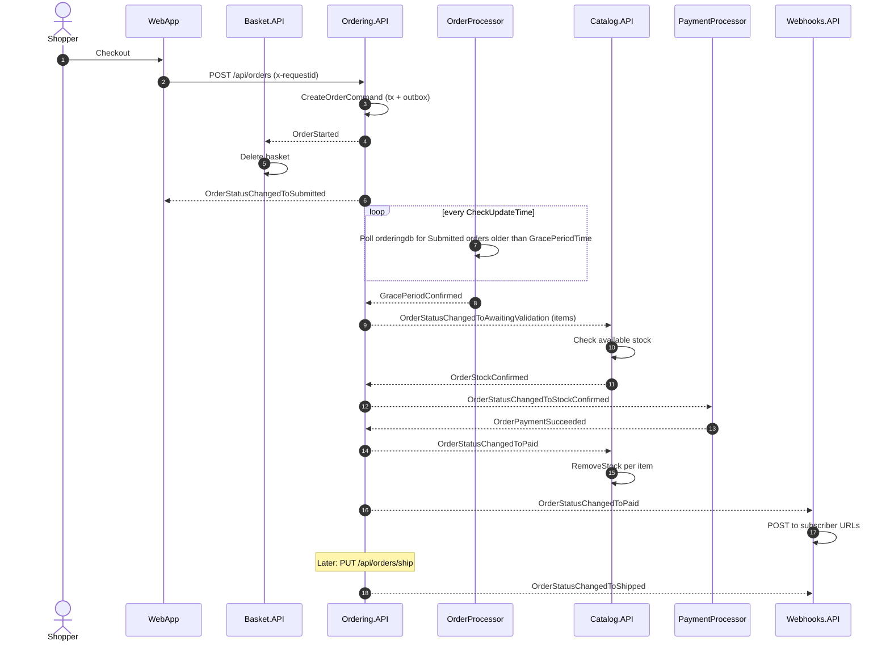
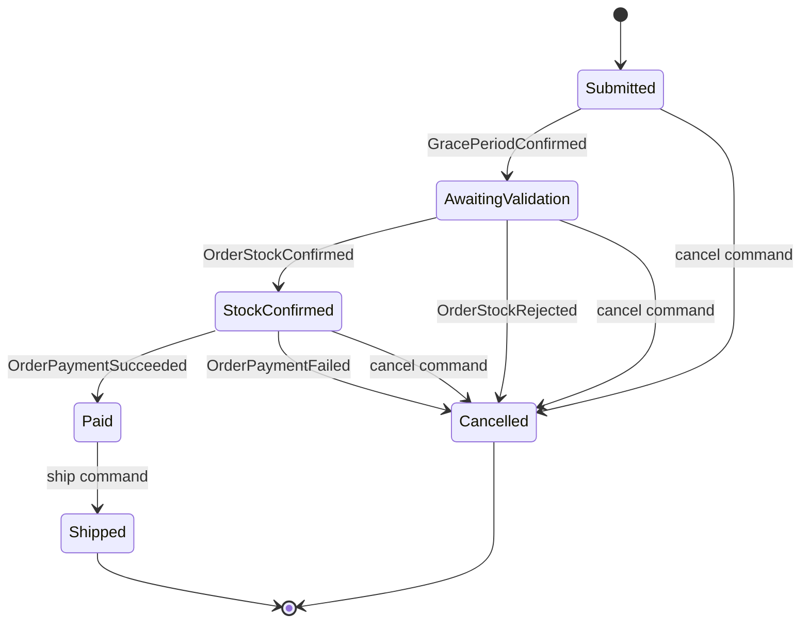
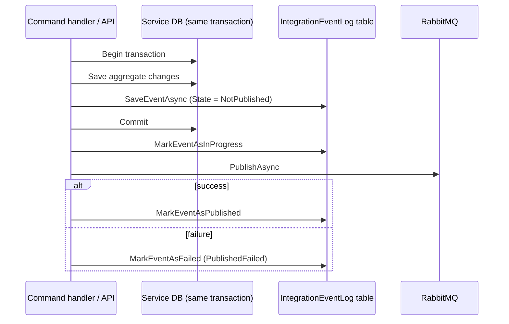

# Event Flows

eShop services integrate asynchronously through RabbitMQ. This document lists every integration event and walks through the order-fulfilment saga.

## 1. Event bus mechanics

- **Transport:** single RabbitMQ direct exchange `eshop_event_bus`. The routing key is the event's CLR type name.
- **Queues:** each service declares one durable queue named after its `EventBus:SubscriptionClientName` and binds it to the routing keys it subscribes to (`AddSubscription<TEvent, THandler>()`).
- **Publishing:** `RabbitMQEventBus.PublishAsync` serializes to JSON, injects W3C trace context into message headers, and retries with Polly (`EventBus:RetryCount`).
- **Consuming:** manual ack (`autoAck: false`), but the message is **always acked, even when the handler throws** - there is no dead-letter exchange or redelivery.

## 2. Event catalog

| Event | Publisher | Subscribers | Trigger |
| --- | --- | --- | --- |
| `OrderStartedIntegrationEvent` | Ordering | Basket | Order created - clear basket |
| `OrderStatusChangedToSubmittedIntegrationEvent` | Ordering | WebApp | Buyer validated/created for new order |
| `GracePeriodConfirmedIntegrationEvent` | OrderProcessor | Ordering | Grace period elapsed for a `Submitted` order |
| `OrderStatusChangedToAwaitingValidationIntegrationEvent` | Ordering | Catalog, WebApp | Order moved to stock validation |
| `OrderStockConfirmedIntegrationEvent` | Catalog | Ordering | All items in stock |
| `OrderStockRejectedIntegrationEvent` | Catalog | Ordering | One or more items out of stock |
| `OrderStatusChangedToStockConfirmedIntegrationEvent` | Ordering | PaymentProcessor, WebApp | Stock confirmed |
| `OrderPaymentSucceededIntegrationEvent` | PaymentProcessor | Ordering | Simulated payment OK |
| `OrderPaymentFailedIntegrationEvent` | PaymentProcessor | Ordering | Simulated payment failed |
| `OrderStatusChangedToPaidIntegrationEvent` | Ordering | Catalog, Webhooks, WebApp | Paid - Catalog decrements stock |
| `OrderStatusChangedToShippedIntegrationEvent` | Ordering | Webhooks, WebApp | Order shipped (`PUT /api/orders/ship`) |
| `OrderStatusChangedToCancelledIntegrationEvent` | Ordering | WebApp | Cancelled by user, stock rejection, or payment failure |
| `ProductPriceChangedIntegrationEvent` | Catalog | Webhooks | Item price updated |

> Event contracts are duplicated as separate record types in each service (no shared contracts package). Compatibility relies on matching type names and JSON shape.

## 3. Order fulfilment saga (happy path)

Compensating paths:

- `OrderStockRejected` -> Ordering sets status `Cancelled` and publishes `OrderStatusChangedToCancelled`.
- `OrderPaymentFailed` -> Ordering sets status `Cancelled`.
- User cancel (`PUT /api/orders/cancel`) is only allowed before `Paid`.

## 4. Order state machine

## 5. Transactional outbox

Catalog and Ordering use `IntegrationEventLogEF` so state changes and outgoing events commit atomically.

- Ordering: `TransactionBehavior` (MediatR pipeline) opens the transaction, then calls `PublishEventsThroughEventBusAsync(transactionId)` after commit.
- Catalog: `CatalogIntegrationEventService.SaveEventAndCatalogContextChangesAsync` + `PublishThroughEventBusAsync`.
- **Gap:** there is no background relay that re-reads `NotPublished`/`PublishedFailed` rows. If the process crashes after commit, or publish fails, the event is never delivered. See [recommendations.md](recommendations.md).

## 6. Domain events (Ordering, in-process)

Domain events are raised by aggregates and dispatched by MediatR inside `OrderingContext.SaveEntitiesAsync`, before the transaction commits. Their handlers translate them into integration events via `AddAndSaveEventAsync` (outbox):

| Domain event | Handler outcome |
| --- | --- |
| `OrderStartedDomainEvent` | Create/verify `Buyer` + payment method, then `OrderStatusChangedToSubmitted` |
| `BuyerPaymentMethodVerifiedDomainEvent` | Link buyer/payment method to the order |
| `OrderStatusChangedToAwaitingValidationDomainEvent` | `OrderStatusChangedToAwaitingValidation` |
| `OrderStatusChangedToStockConfirmedDomainEvent` | `OrderStatusChangedToStockConfirmed` |
| `OrderStatusChangedToPaidDomainEvent` | `OrderStatusChangedToPaid` (with stock items) |
| `OrderShippedDomainEvent` | `OrderStatusChangedToShipped` |
| `OrderCancelledDomainEvent` | `OrderStatusChangedToCancelled` |
