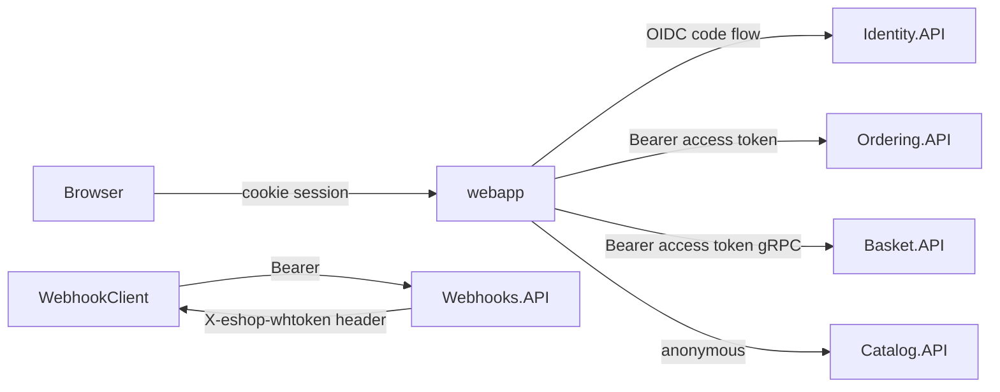

# Infrastructure, Security, and Operations

## 1. Orchestration with Aspire

`src/eShop.AppHost` is the single source of truth for topology.

| Resource | Type | Notes |
| --- | --- | --- |
| `redis` | Container | Parent-related to `basket-api` |
| `eventbus` | RabbitMQ container | `ContainerLifetime.Persistent` |
| `postgres` | `ankane/pgvector:latest` container | Persistent; hosts `catalogdb`, `identitydb`, `orderingdb`, `webhooksdb` |
| `identity-api`, `catalog-api`, `basket-api`, `ordering-api`, `order-processor`, `payment-processor`, `webhooks-api`, `webapp`, `webhooksclient` | .NET projects | Wired via `WithReference` (connection strings + service discovery) and `WaitFor` |
| `mobile-bff` | YARP | Routes configured in `Extensions.ConfigureMobileBffRoutes` |
| `foundry` (opt-in `UseFoundry=true`) | Azure AI Foundry | `chatModel` = gpt-4.1-mini, `textEmbeddingModel` = text-embedding-3-small, referenced by catalog-api and webapp |
| Ollama (code toggle `useOllama`) | Container | `llama3.1` chat, `all-minilm` embeddings |
| `aca` | Azure Container Apps environment | Deployment target for `aspire deploy` / `azd` |

Other AppHost behaviours:

- `AddForwardedHeaders()` sets `ASPNETCORE_FORWARDEDHEADERS_ENABLED` for every project (needed behind ACA ingress).
- `ESHOP_USE_HTTP_ENDPOINTS=1` forces HTTP launch profiles (used by Playwright CI).
- Identity receives every client's callback URL, creating an intentional cyclic reference.

## 2. Service defaults (`eShop.ServiceDefaults`)

Every service calls `builder.AddServiceDefaults()`:

- OpenTelemetry logging, metrics (ASP.NET Core, HttpClient, runtime) and tracing (ASP.NET Core, gRPC, HttpClient, plus `Experimental.Microsoft.Extensions.AI` and the RabbitMQ activity source), exported via OTLP to the Aspire dashboard.
- Default health checks; `/health` and `/alive` are mapped **only in Development**.
- Service discovery and `AddStandardResilienceHandler()` on all `HttpClient`s.
- `AddDefaultAuthentication()` - JWT bearer validation against `Identity:Url`. `Identity:Audience` is set, but `ValidateAudience = false`, so any token from the authority is accepted by every API.
- `AddDefaultOpenApi()` - versioned OpenAPI docs with Scalar UI and OAuth security scheme.

## 3. Security model

| Area | Current state |
| --- | --- |
| Authority | Duende IdentityServer, in-memory clients/scopes, developer signing credential |
| Users | ASP.NET Core Identity in `identitydb`, seeded demo users |
| API authorization | Ordering and Webhooks: `RequireAuthorization()` on the route group. Basket: per-method via user claim. Catalog: **no authentication on any endpoint**, including create/update/delete |
| Token validation | Issuer validated; audience **not** validated (`ValidateAudience = false`) |
| Service-to-service | No mTLS or service identity; trust is network-based plus JWT where configured |
| Webhooks | Grant-URL `OPTIONS` handshake with shared token; outbound POST carries `X-eshop-whtoken` (no HMAC signature) |
| Secrets | Aspire generates DB/RabbitMQ passwords; `appsettings.Development.json` files contain placeholder local passwords |

## 4. Data ownership

| Store | Owner | Contents |
| --- | --- | --- |
| `catalogdb` | Catalog.API | `CatalogItem` (with `Embedding vector(384)`), `CatalogBrand`, `CatalogType`, outbox |
| `identitydb` | Identity.API | ASP.NET Identity tables |
| `orderingdb` | Ordering.API (OrderProcessor reads) | `ordering` schema: orders, order items, buyers, payment methods, card types, requests (idempotency), outbox |
| `webhooksdb` | Webhooks.API | Subscriptions |
| Redis | Basket.API | Baskets keyed by buyer id (ephemeral) |

Each service applies its own EF Core migrations and seed data on startup (`MigrateDbContextAsync` helper in `src/Shared`).

## 5. Observability

- Distributed tracing spans HTTP, gRPC, and RabbitMQ publish/receive (trace context propagated through message headers), so a checkout can be followed end-to-end in the Aspire dashboard.
- Structured logging via `ILogger` with event IDs in integration-event handlers.
- No custom business metrics (orders/min, payment failure rate, stock rejections) are emitted.

## 6. Build, test, CI

| Workflow | What it does |
| --- | --- |
| `pr-validation.yml` | `dotnet build eShop.Web.slnf` and `dotnet test` (unit + functional; functional tests spin up containers via Aspire/Testcontainers-style fixtures) |
| `pr-validation-maui.yml` | Installs MAUI workloads and builds the mobile apps |
| `playwright.yml` | Runs Playwright E2E (`e2e/`: browse, cart, checkout, login setup) against the running AppHost |
| `markdownlint.yml` | Lints Markdown |

Test projects (approximate test-method counts): Ordering.UnitTests (40), ClientApp.UnitTests (40), Catalog.FunctionalTests (19), Application.UnitTests (17), Ordering.FunctionalTests (11), Basket.UnitTests (9), eShop.AppHost.UnitTests (5), Basket.FunctionalTests (2), Webhooks.FunctionalTests (2). There are no tests for PaymentProcessor, OrderProcessor, Identity.API, or the RabbitMQ event bus.

## 7. Deployment

- Target: Azure Container Apps via the `aca` environment (`aspire deploy` / `aspire publish`, or `azd`).
- Postgres, Redis, and RabbitMQ run as containers by default; there are no Azure-managed equivalents (Azure Database for PostgreSQL, Azure Cache for Redis, Service Bus) configured in the AppHost.
- No IaC beyond what Aspire generates; no environment-specific (dev/test/prod) AppHost configuration.
