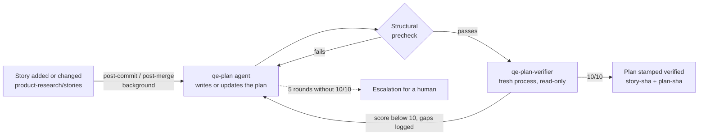
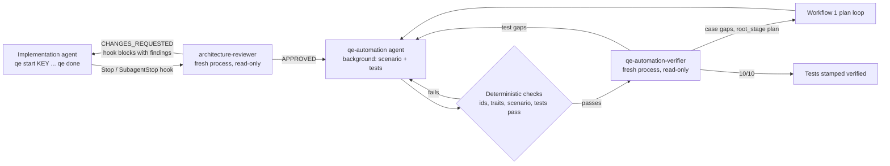

# QE agent pipeline

Agents turn each user story into a verified integration test plan, and, once the implementation of a story is complete and architecture-approved, into verified automated tests. Every artifact an agent produces is checked by a separate verifier agent that starts with a clean context and loops until it scores 10/10. Every denial is logged, and recurring denials become lessons that the agents read on their next run.

The runner is `scripts/qe/qe.mjs` (Node 20, no dependencies). It drives a headless agent CLI: Claude Code by default, or Copilot CLI or Codex (`QE_AGENT_CLI=copilot|codex`), or any command (`QE_AGENT_CMD`, prompt on stdin).

## Workflow 1: story to test plan



- Output: `tests/plans/<story-file-name>/_index.md` plus one `TC-<KEY>-NN-<slug>.md` per case, covering every happy and sad path (see [tests/plans/README.md](../tests/plans/README.md)).
- The runner owns the index front matter. `story-sha` records the story text the plan was written for. When the story changes, the plan becomes stale and the agent gets the story diff and updates the affected cases in place, keeping the ids of the others stable.
- The verifier sees only the story and the plan. It never sees the planner's reasoning.

## Workflow 2: implementation to automated tests



1. The implementation agent runs `node scripts/qe/qe.mjs start <KEY>` when it starts a story (or works on a branch named after it), and `node scripts/qe/qe.mjs done` when the line of work is complete.
2. When the agent's turn ends, the Stop hook runs the architecture review on the implementation diff (tests and plans excluded). Changes requested block the stop and send the findings back to the agent as its next instruction. Each correction triggers a new review round with a fresh reviewer, up to 5 rounds.
3. On approval, the hook starts the automation loop in the background and lets the agent finish. If the implementation changes again (for example after a later correction), the next approval re-runs automation in update mode, so the tests follow the corrected code.
4. The automation loop writes `testing/scenarios/<key>/scenario.yaml` and tests whose names carry their case ids, runs them, and loops with the automation verifier until it scores 10/10. If the tests show that the implementation contradicts the plan, the run stops with a `product-bug` escalation instead of weakening the tests.
5. Every recorded Playwright test also captures labeled keyframes (screenshots at each step, demo checkpoint and the final or failure state; see the `feature-demo-video` skill), listed in `artifacts/e2e-videos/manifest.json`. When the pipeline's test run fails, the feedback to the automation agent includes each failed test's error and keyframe paths. When the tests pass, the verifier gets every test's keyframes and checks that the screen matches each case (`visual-mismatch`). Only a manifest written by that run is used. The pipeline runs its Playwright tests with `E2E_KEEP_VIDEOS=1`, because passing tests otherwise keep no video or keyframes.

## Where it hooks in

| When | Hook | What runs | Cost |
| --- | --- | --- | --- |
| Agent session start/resume | `SessionStart` in `.claude/settings.json`, `.codex/hooks.json` | `qe hook session-start`: active story, stale plans, escalations | none |
| Agent turn ends | `Stop` and `SubagentStop` (Claude Code and Copilot CLI read `.claude/settings.json`; Codex reads `.codex/hooks.json`) | `qe hook stop`: review state machine, starts automation | LLM, only after `qe done` |
| Commit or merge touching stories | `.githooks/post-commit`, `.githooks/post-merge` | `qe git-hook ...`: plan loop in the background | LLM |
| Push | `.githooks/pre-push` | `qe check --pre-push`: plans and tests for touched stories are verified and current | none |
| Pull request | `.github/workflows/qe-pipeline.yml` | pipeline tests and `qe check` | none |
| Weekly | `.github/workflows/qe-lessons.yml` | `calibrate`, `metrics`, `lessons` (opens a PR) | LLM |

`scripts/setup.sh` already points `core.hooksPath` at `.githooks`. Opt out of automatic planning on commit with `git config qe.autoPlan false`; opt in to lessons runs after merges with `git config qe.autoLessons true`. Bypass the pre-push gate once with `QE_SKIP=1 git push`; CI still enforces it. `QE_DISABLE=1` turns all hooks off.

Agents spawned by the pipeline run with `QE_PIPELINE_CHILD=1`, so their own Stop hooks and git hooks do nothing and cannot recurse.

## Verifier loops

- Each round starts a new verifier process whose prompt holds only what it needs: the story and plan for plans; the case files, the tests and the scenario for automation. It cannot see the producer's reasoning or earlier verdicts.
- Cheap deterministic checks run before any verifier call (front matter, sections, happy and sad cases, index lists every id; every case has a test, no orphan ids, `[Trait("Story", ...)]`, scenario validates, tests pass).
- A verdict passes only at the required score (10) with no gaps; a lower score without gaps counts as an unexplained gap. Gaps go back to the producer as its next task.
- Automation gaps the verifier traces to the case itself (`root_stage: plan`) are sent to the plan loop and attributed to the plan agent in the metrics.
- After 5 rounds without 10/10, the loop stops and writes `.agent-state/escalations/<KEY>-<stage>.md`, which the next agent session is told about.

## Observability

All results are appended to `.agent-metrics/*.jsonl`, which are committed with the plans and tests they describe (`merge=union` keeps every record across branches):

| File | One record per |
| --- | --- |
| `verifier-runs.jsonl` | verifier round: stage, story, round, score, passed, producer and verifier prompt versions |
| `verifier-denials.jsonl` | gap: category, subtype, case, detail, location, `root_stage`, `attributed_agent` |
| `precheck-failures.jsonl` | failed deterministic check |
| `arch-reviews.jsonl` | architecture review round and its findings |
| `calibration.jsonl` | audit of a past 10/10 verdict (`agreed`, or each gap the verifier missed) |

`node scripts/qe/qe.mjs metrics` (or `--json`) reports denial rates, first-round pass rates, rounds to 10/10, denials by category and agent, the trend for each prompt version (a version is the hash of the agent file plus its lessons), cross-stage denials and calibration misses.

## Auto-improvement

`node scripts/qe/qe.mjs lessons` reads the metrics and, for each of `qe-plan`, `qe-automation`, `qe-plan-verifier` and `qe-automation-verifier`:

- **adds** a rule when a denial category recurs in 3 or more stories and no rule covers it;
- **strengthens** a rule when its category keeps recurring in 3 or more stories after the rule was added;
- **retires** a rule when its category has not recurred for 10 stories;
- **reverts** a rule when the denial rate for its category did not drop after it was added.

The `qe-lessons` agent writes the rules into `.github/agents/lessons/<agent>.md` (at most 15 each), and the command opens a pull request, so every change to agent behavior is reviewed like code. Each rule carries a marker with its category and date, which is what makes the retire and revert measurements possible. The lessons file is appended to the agent's prompt on every run, and it is part of the prompt version, so the metrics show whether a change helped.

Verifiers improve through calibration: `qe calibrate` re-audits recent 10/10 verdicts with a stricter auditor (optionally a different model, `agent.models.audit`), and gaps the verifier missed become lessons for that verifier.

Tune thresholds, round limits, models and categories in `scripts/qe/config.json`.

## Commands

```bash
node scripts/qe/qe.mjs start PROMO-3           # implementation agent: begin a story
node scripts/qe/qe.mjs done                    # implementation agent: line of work complete
node scripts/qe/qe.mjs status [PROMO-3]
node scripts/qe/qe.mjs plan PROMO-3 | --stale | --all [--force] [--background]
node scripts/qe/qe.mjs automate PROMO-3 [--skip-tests] [--background]
node scripts/qe/qe.mjs review PROMO-3          # one review round, printed
node scripts/qe/qe.mjs check [--all] [--changed-from origin/main]
node scripts/qe/qe.mjs metrics [--json] [--since 2026-01-01]
node scripts/qe/qe.mjs calibrate [--stage plan|automation] [--sample 3]
node scripts/qe/qe.mjs lessons [--dry-run] [--local]
npm run test:qe                                # pipeline tests (fake agent, no LLM)
```

Runtime state (locks, logs, per-story state, escalations) lives in `.agent-state/`, which is not committed. Background runs log to `.agent-state/logs/`.
